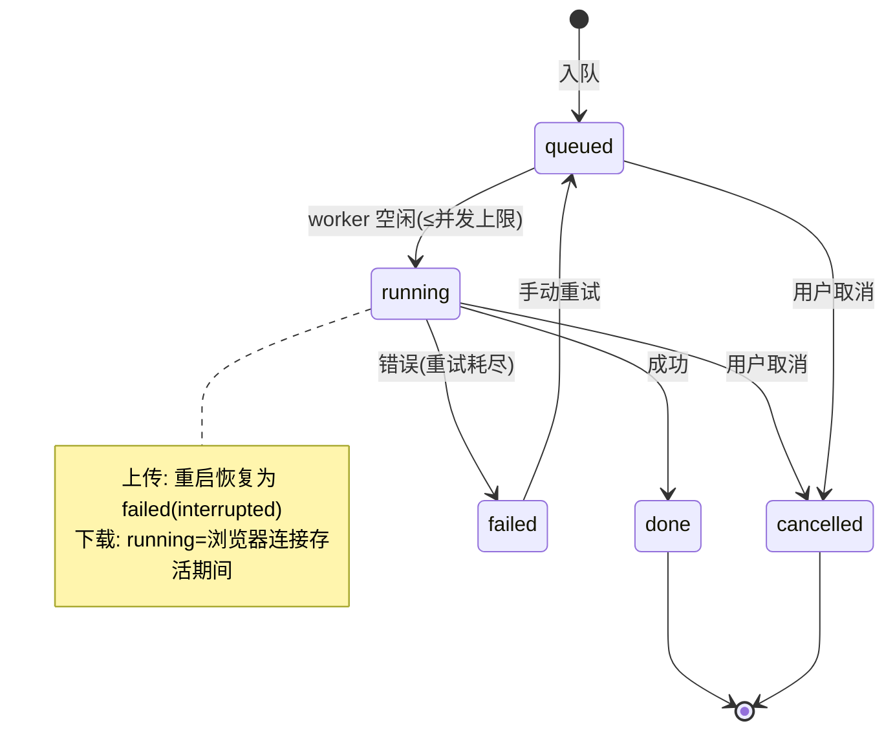
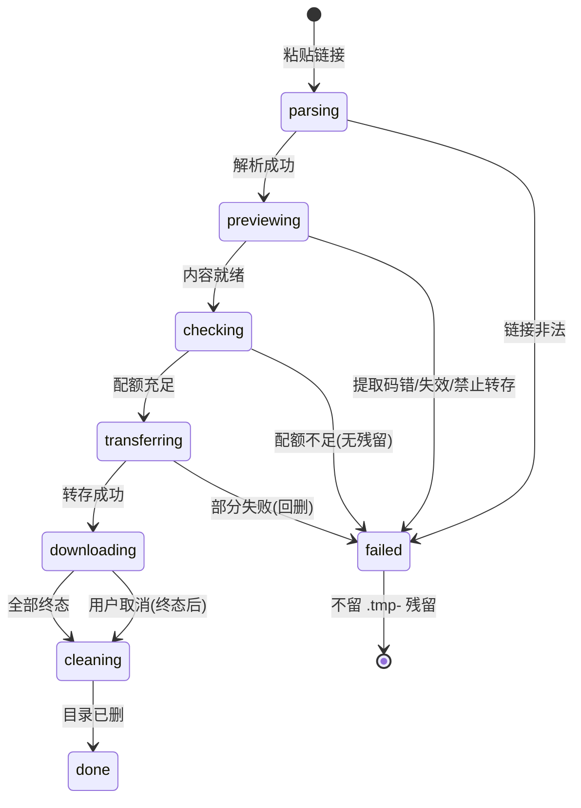

# BaiduPCS-Go Web 客户端 · 架构设计

- 项目: /home/time/doc/ai/make-tools(模块名 `baidupcs-web`)
- 依据: docs/requirements-baidupcs-web.md(approved, D1~D9 已裁决)
- 上游基线: github.com/qjfoidnh/BaiduPCS-Go **v4.0.2**(D9 锁定)
- 日期: 2026-10-24
- 阅读约定: FR-xx 为需求条目编号; W(n) 为任务波次表中波次

## 0. 上游代码调研结论(v4.0.2 实测源码, 修正任务书假设)

> 调研方式: git clone 不可用(本会话无 shell), 改用 jsDelivr CDN 逐文件拉取 v4.0.2 tag
> 源码(带内容哈希校验), 结论与需求文档"internal/baidupcs"表述有出入, 以本节为准。

### 0.1 重要修正: 包路径与可见性

| 任务书假设 | v4.0.2 实际 | 影响 |
|---|---|---|
| `internal/baidupcs` | 核心库在仓库根 **`baidupcs/`**(公开包) | 可直接 import, 无障碍 |
| 直接 import `internal/pcsconfig` 管理多账号/配置 | **不可行**: Go internal 可见性规则禁止外部模块 import 上游 `internal/*` | 多账号与传输配置必须在本项目内自建(见 §5.3 适配层), 这也是"隔离上游变动"的正确落点 |

**新项目 import 的确切包路径(全部调用面)**:

```go
import (
    "github.com/qjfoidnh/BaiduPCS-Go/baidupcs"        // 核心 API: BaiduPCS 类型与全部业务方法
    "github.com/qjfoidnh/BaiduPCS-Go/baidupcs/pcserror" // 错误模型: Error 接口/Decode*JSONError
    // 按需(下载代理/上传引擎底层, W3/W4 再引入):
    "github.com/qjfoidnh/BaiduPCS-Go/requester"               // HTTPClient/ParseCookieStr/UserAgent
    "github.com/qjfoidnh/BaiduPCS-Go/requester/rio"           // NewFileReaderAtLen64(上传喂文件)
    "github.com/qjfoidnh/BaiduPCS-Go/requester/uploader"      // NewMultiUploader(分片上传引擎)
)
```

上游 go.mod `go 1.23`, 与本项目 go.mod 一致(本机 Go 1.27.1 向下兼容)。
上游依赖较重(beego/rice/liner 等 CLI 遗产), 但 `go mod tidy` 后只有被 import 包的依赖进入构建;
`baidupcs` 包本身的传递依赖含 `json-iterator/gjson/tablewriter/baidu-tools(取 uid)` 等,
GOPROXY 需可用(见 §11 风险)。

### 0.2 BaiduPCS 结构与凭证管理

```go
// baidupcs/baidupcs.go
type BaiduPCS struct { appID int; isHTTPS bool; uid uint64;
    client *requester.HTTPClient; accessToken, pcsUA, pcsAddr, panUA string; ... }

func NewPCS(appID int, bduss string) *BaiduPCS          // 仅 BDUSS
func NewPCSWithCookieStr(appID int, cookieStr string) *BaiduPCS  // 整串 Cookie(FR-01 方式一)
func NewPCSWithClient(appID int, client *requester.HTTPClient) *BaiduPCS

// 凭证/环境装配(链式调用):
func (pcs *BaiduPCS) SetStoken(stoken string)     // STOKEN 必须另设(分享/秒传需要, FR-01)
func (pcs *BaiduPCS) SetUID(uid uint64)           // locate/download 签名需要
func (pcs *BaiduPCS) SetHTTPS(bool); SetPCSUserAgent(ua); SetPanUserAgent(ua)
func (pcs *BaiduPCS) SetPCSAddr(addr); SetStaticPCSAddr(bool); SetAPPID(int)
func (pcs *BaiduPCS) SetaccessToken(token string) // 秒传转存用
func (pcs *BaiduPCS) GetClient() *requester.HTTPClient   // 下载代理取 jar/UA 用
func (pcs *BaiduPCS) UpdatePCSCookies(reverse bool)      // 分享转存流程后整理 cookie(必须调用)
const NetdiskUA = "netdisk;P2SP;3.0.0.8;netdisk;11.12.3;ANG-AN00;android-android;10.0;JSbridge4.4.0;jointBridge;1.1.0;"
const PanAppID = "250528" // 分享系接口用; 传输 appID 默认 266719(上游 InitDefaultConfig)
```

### 0.3 各域 API 入口(实测签名)

| 域(FR) | 入口签名 |
|---|---|
| 配额 FR-05 | `QuotaInfo() (quota, used int64, pcsError pcserror.Error)`; `SpaceLeftInfo() (free, err)`(FR-40 配额预检直接可用) |
| 列表 FR-06 | `FilesDirectoriesList(path string, options *OrderOptions) (FileDirectoryList, pcsError)` — **v4.0.2 已内置 page 循环分页(每页 1000, fs_id 去重防死循环), >1000 对象目录天然支持**; 排序 `OrderOptions{By: OrderByName/Time/Size, Order: OrderAsc/Desc}` |
| 元信息 FR-09 | `FilesDirectoriesMeta(path) (*FileDirectory, pcsError)`; 批量 `FilesDirectoriesBatchMeta(paths ...string)` |
| 树 FR-08 | `FilesDirectoriesRecurseList(path, options, HandleFileDirectoryFunc) (FileDirectoryList)`(回调控制递归深度/maxDepth) |
| 搜索 FR-10 | `Search(targetPath, keyword string, recursive bool) (FileDirectoryList, pcsError)` — 仅文件名、不含目录(与 FR-10 降级说明一致) |
| 建/删 FR-21/22 | `Mkdir(pcspath string) error`; `Remove(paths ...string) error`(整批语义, 任一失败整批错, 与 FR-22 一致) |
| 复制/移动/改名 FR-23/24 | `Copy(cpmvJSON ...*CpMvJSON)`; `Move(...)`; `Rename(from, to string)`(CpMvJSON{From, To}) |
| 下载直链 FR-11 | `LocateDownload(pcspath string) (*URLInfo, pcsError)` → `URLInfo.SingleURL(https bool) *url.URL`; 备选 `DownloadFile/DownloadStreamFile(path, DownloadFunc)`(pcs/stream 模式); **dlink 请求必须带 NetdiskUA**, 参考上游 `panHTTPClient()`: PanUA 客户端 + CheckRedirect 去 Referer + SetTimeout(6min) + CloneJarWithDomain(拷贝网盘 cookie 到 dlink 域) |
| 秒传导出 FR-13 | `ExportByFileInfo(finfo *FileDirectory) (*RapidUploadInfo, pcsError)`(RapidUploadInfo{Filename, ContentLength, ContentMD5, SliceMD5, ContentCrc32}) |
| 上传 FR-15/16 | 引擎: `uploader.NewMultiUploader(NewPCSUpload(pcs, targetPath), rio.NewFileReaderAtLen64(file), MultiUploaderConfig{Parallel, BlockSize, MaxRate, Policy}, savePath)` + `OnSuccess/OnError/OnUploadStatusEvent` + `Execute()`; 低层: `RapidUpload(...)`/`FakeRapidUpload(targetPath, policy, length)`(跳过秒传的 precreate)/`UploadTmpFile(uploadid, targetPath, partseq, partOffset, UploadFunc)`/`UploadCreateSuperFile(uploadid, policy, fileSize, targetPath, checksumMap)`; 策略常量 `SkipPolicy/OverWritePolicy/RsyncPolicy`("skip"/"overwrite"/"rsync"); 分片尺寸常量 Min 4MB/Middle 16MB/Max 64MB(按文件大小 8G/32G 阈值升档, 上游 `getBlockSize`) |
| 分享 FR-25~27 | `ShareSet(paths []string, option *ShareOption{Password, Period, IsCombined}) (*Shared{Link,Pwd,ShareID}, err)`(密码空则自动随机 4 位); `ShareList(page int)`; `ShareCancel(shareIDs []int64)`; `ShareSURLInfo(shareID)`(含密码) |
| 转存 FR-28 | **无单函数转存, 是多步流程**(上游 `pcscommand.RunShareTransfer`, 需照抄编排): ①正则抽链接/`?pwd=`(`(https?://pan\.baidu\.com/s/[0-9A-Za-z_-]+)(?:\?pwd=([0-9A-Za-z]{4}))?`) ②featureStr=路径 base(短链 "init" 时取 `1`+surl) ③`AccessSharePage(featureStr, true)` 取 shareid/uk/bdstoken(失效/404 在此暴露) ④`GenerateShareQueryURL("verify",...)+PostShareQuery(...)` 验提取码(errno -9=提取码错误) ⑤`UpdatePCSCookies(true)` ⑥再次 `AccessSharePage(featureStr, false)` ⑦`GenerateShareQueryURL("list",...)+ExtractShareInfo(...)` 取 fs_id 列表 ⑧`GenerateRequestQuery("POST", transMetas)` 执行转存(errno 12=超数/-30=重名/4=重复); FR-40 的 SharePreview 复用 ①~⑦ |
| 离线 FR-29/30 | `CloudDlAddTask(sourceURL, savePath) (taskID, err)`; `CloudDlListTask()`; `CloudDlQueryTask(taskIDs []int64)`(≤100/次); `CloudDlCancelTask(id)`; `CloudDlDeleteTask(id)`; `CloudDlClearTask() (total, err)`; 状态码 0成功/1进行中/2系统错误/3资源不存在/4超时/5失败/6空间不足/7取消(`ParseText()` 已给中文) |
| 回收站 FR-31~33 | `RecycleList(page int)`; `RecycleRestore(fidList ...int64)`; `RecycleDelete(fidList ...int64)`; `RecycleClear() (sussNum, err)` |
| 通配符 FR-35 | `MatchPathByShellPattern(pattern string) ([]string, pcsError)`(pattern 须绝对路径) |

### 0.4 错误处理模式(PCSApiRes 的实际形态)

上游不叫 PCSApiRes, 统一为 **`pcserror.Error` 接口**:

```go
type Error interface {
    error
    GetOperation() string; GetErrType() ErrType
    GetRemoteErrCode() int; GetRemoteErrMsg() string; GetError() error
}
// ErrType: ErrTypeInternalError | ErrTypeRemoteError | ErrTypeNetError
//        | ErrTypeJSONParseError | ErrTypeOthers
```

适配层映射约定(服务层依赖此表转中文):
- `ErrTypeRemoteError` + `GetRemoteErrCode()`: 4/-6=凭证失效→ErrAuth; 31066/112=不存在→ErrNotFound; 31112=配额满→ErrQuota; -9=提取码错→ErrBadPasscode; 31061 重名/114514 skip 命中/1919810 rsync 命中=策略语义; 31363=上传状态过期(可重试); 31626=UA 不对(下载, 可重试)
- `ErrTypeNetError` → ErrNet(下载代理按 Range 重试)
- 其余 → ErrInternal(原文记日志, 不透传给浏览器)

### 0.5 pcsconfig 字段 → Web 设置页映射(FR-34)

**可写**(白名单): `max_parallel`(默认 1, D6)、`max_download_load`、`max_upload_parallel`、`max_upload_load`、`max_download_rate`、`max_upload_rate`、`u_policy`、`savedir`(仅展示, Web 下载不落盘)、`user_agent`(高级折叠)。
**只读**(风控敏感, 改动即 403 风险): `appid`、`pcs_ua`、`pan_ua`、`pcs_addr`、`fix_pcs_addr`、`enable_https`、`proxy*`、`local_addrs`。
实现: 上游 `pcsconfig` 不可 import, 因此我们的 config 包持久化同名字段的**白名单子集**, 每次构造 BaiduPCS 时逐字段 `Set*` 应用(§5.3); 上游配置文件格式不做兼容承诺(FR-34 "保存即写入上游兼容的配置文件"修正为: 写入本项目 config.json, 字段名与上游对齐, 便于人工迁移)。

### 0.6 上游多账号机制(供我们的适配层仿制)

上游 `pcsconfig`: `BaiduUserList []*Baidu`(字段 uid/name/bduss/stoken/ptoken/baiduid/sboxtkn/cookies/accesstoken/workdir)+ `BaiduActiveUID` + `SwitchUser/DeleteUser/SetupUserByBDUSS`; 每 Baidu 经 `Baidu.BaiduPCS()` 构造独立 BaiduPCS(注入 BDUSS/STOKEN/UID/UA/HTTPS)。`NewUserInfoByBDUSS` 走 tieba 接口取 uid/昵称, 不可用时 `NewUserInfoByInput(bduss, name)` 兜底(uid 置 24)。
我们照此在 `xengine` 内实现: 凭证 JSON(`accounts.json`, 0600)+ 实例池 `map[uid]*baidupcs.BaiduPCS` + activeUID; 切账号=换池指针, 任务持有创建时的 pcs 引用(FR-03 任务不中断)。

## 1. 分层架构

```text
┌────────────────────────────────────────────────────────────┐
│ L1 前端 SPA(纯 HTML+原生 ES Module+petite-vue, embed 内嵌) │
│    登录/文件/传输/分享/离线/回收站/设置 7 页                │
└──────────────▲──────────────────────────────────────────────┘
               │ REST JSON + SSE(/api/events) + 流式 GET(/api/dl)
┌──────────────┴──────────────────────────────────────────────┐
│ L2 接入层 internal/server: net/http 1.22+ 路由 + 中间件链   │
│    session 校验 → 限速 → 脱敏日志 → panic recovery          │
├─────────────────────────────────────────────────────────────┤
│ L3 服务层: uploader(分片接收) xfer(任务/下载代理)          │
│    sharetmp(FR-40 编排) session tempmgr taskdb config      │
├─────────────────────────────────────────────────────────────┤
│ L4 适配层 internal/xengine: 唯一 import 上游的包,          │
│    Engine 接口 + 凭证/实例池 + pcserror→ErrCode 映射        │
├─────────────────────────────────────────────────────────────┤
│ L5 上游库 baidupcs / pcserror / requester(只被 L4 import)  │
└─────────────────────────────────────────────────────────────┘
硬件/OS: 本地 Linux(amd64/arm64), 磁盘(临时目录/数据目录), 出网 pan.baidu.com
```

层间调用规则: 只允许上层调下层; L3 不得直接 import 上游包(编译期由 code review 把关,
W6 加 import 边界检查脚本); L4 对上只暴露 `Engine` 接口与镜像类型。

### 路由选型(定稿)

标准库 `net/http`(Go 1.22+ ServeMux: 方法+通配, `POST /api/tasks/{id}/cancel` 原生支持)。
理由: 需求端点全部可表达; 零依赖利于离线构建与单二进制(NFR-05); chi 优势(中间件生态)用不上,
我们自建中间件链不足 80 行。代价: 无路由级文档生成, 用接口文档 §8 补偿。

## 2. 并发模型(Linux 服务, 无裸机/RTOS 语义)

| 任务/goroutine | 触发 | 职责 | 并发上限 |
|---|---|---|---|
| http serve M | 每连接 | API 处理 | Go 默认 |
| 引擎上传 worker ×2 | xfer 队列 | 调 xengine.Upload(临时文件→百度) | max_upload_load(默认 2, FR-18) |
| 下载代理 ×N | 浏览器请求 | 流式转发 | max_download_load(默认 3, FR-14)+排队信号量 |
| 分片接收 ×M | 上传 chunk | 顺序写临时文件 | 每会话串行 |
| 孤儿扫描 ×1 | ticker 5min | tempmgr 清理 | 1 |
| SSE 广播 ×1 | 事件总线 | 进度推送 ≤500ms | 1 写多读 |
| quota 缓存刷新 ×1 | ticker 60s | FR-05 | 1 |

IPC: 进程内 channel + sync; 无跨进程。锁秩序(防死锁): taskdb → xfer → engine, 禁止逆向。
阻塞原语只用 `context` 取消与带缓冲 channel, 不用 time.Sleep 轮询业务状态。

## 3. 内存与磁盘设计

- 下载代理: 每流 `io.Copy` + 32KB 内核缓冲 + 可选 4MB 用户缓冲(配速时), 上限受 NFR-03;
  环形缓冲语义=任意时刻临时增长 ≤32MB(NFR-04), 由"不落盘+固定缓冲"结构性保证。
- 上传分片: chunk 8MB; MD5 流式计算(接收中同步算 MD5, 峰值=分片+哈希状态 ≪100MB)。
- 任务库: tasks.json 全量内存驻留(数千条 ≪1MB), 终态才写盘。
- 磁盘: 数据目录(~/.local/share/baidupcs-web: config.json/accounts.json/tasks.json/session.key,
  全部 0600, 预算 ≤50MB NFR-04); 临时目录(D4)水位 2GB(FR-17)。
- 写盘纪律: 一律"临时文件+rename"原子写; 配置/凭证保存即 fsync。

## 4. 通信协议(浏览器 ↔ 服务)

统一 JSON; 错误体 `{"code":"<机器码>","message":"<中文>"}`; 机器码枚举:
`AUTH_REQUIRED/AUTH_LOCKED/AUTH_BAD_PASSCODE/NOT_FOUND/QUOTA_EXCEEDED/RATE_LIMITED/
UPLOAD_CHUNK_MISMATCH/DLINK_EXPIRED/TRANSFER_FORBIDDEN/DISK_LOW/UPSTREAM_ERROR/INTERNAL`。

| 端点 | 方法 | 说明 |
|---|---|---|
| /api/login /logout /password | POST | FR-37; 登录限速 10/min/IP(FR-39) |
| /api/accounts, /api/accounts/{uid}/switch, DELETE /api/accounts/{uid} | GET/POST/DELETE | FR-02/03/04(响应脱敏: 仅 uid/昵称) |
| /api/quota | GET | FR-05(60s 缓存) |
| /api/files?dir&page&sort&order, /api/meta, /api/search | GET | FR-06/09/10 |
| /api/files/mkdir|rm|cp|mv | POST | FR-21~24 |
| /api/upload/init → /chunk → /complete, /abort | POST | FR-15 三段式, 分片 8MB |
| /api/dl?path&token | GET | FR-11 流式代理, token=HMAC 30min(FR-39) |
| /api/tasks, /api/tasks/{id}/cancel|retry|purge | GET/POST | FR-18~20 |
| /api/events | GET(SSE) | FR-19, task 事件 ≤500ms |
| /api/share/set|list|cancel | GET/POST | FR-25~27 |
| /api/transfer | POST | FR-28 |
| /api/share/preview, /api/share/dl?job&fsid&token | POST/GET | FR-40 |
| /api/offline/add|list|query|cancel|delete | GET/POST | FR-29/30 |
| /api/recycle/list|restore|delete | GET/POST | FR-31~33 |
| /api/config, /api/config/set | GET/POST | FR-34(白名单, 风控字段只读 403) |
| /api/match, /api/export, /api/tool/cipher | POST | FR-35/13 + tool 加解密 |

下载 token: `HMAC-SHA256(SessionKey, path|expire|session_fp)` 前 16 字节 hex; 会话指纹绑定防跨会话盗用。
SSE 断线: Last-Event-ID 重放最后快照(简化: 每事件带全量进度, 重放=重发快照)。

## 5. 关键机制设计

### 5.1 流式下载代理(FR-11/D2)

流程: 鉴权→token 校验→xengine.ResolveDlink(带 8h 级缓存, 失效重解一次)→
构造上游同款 netdisk 客户端(UA=NetdiskUA, Referer 剥离, jar 从 BaiduPCS.GetClient().Jar 按
dlink 域克隆——上游 `CloneJarWithDomain` 同款做法)→透传 Range→`io.Copy(w, bdResp.Body)`
(包一层 RateLimiter 与断流计数器)。
断流续取: 已发 N 字节处断开→对百度发 `Range: bytes=(start+N)-` 重连续写, 浏览器无感;
重试 3 次失败→若响应未提交(无 Range/刚建连)回 502, 已提交则强制断开(浏览器按 Range 重试)。
响应头: 200/206、Content-Length、Accept-Ranges: bytes、Content-Disposition
(`attachment; filename*=UTF-8''<rfc5987>`)。权衡: 不实现多连接分片加速(百度限速策略下无益,
且破坏"单直链"语义)。

### 5.2 上传临时文件生命周期(FR-15/16/17/D3/D4)

init(建 0600 临时文件, 水位检查)→chunk(顺序拼接+流式 MD5)→complete(入 xfer 队列,
worker 调 `xengine.Upload{LocalPath: 临时文件}` → 上游引擎秒传→分片)→终态钩子(10s 后删,
`time.AfterFunc` + 任务表引用计数)。秒传命中(FR-16): complete 前若 MD5+size 可秒传,
worker 先 `RapidUpload`, 命中则跳过读盘, 临时文件同样 10s 删除(此时"未接收完即成功"由
浏览器端在 init 应答秒传预检位后跳传实现——W4 细化, 接口已留 noRapid/policy)。
孤儿扫描: 5min ticker, 引用集=xfer 活跃+queue 会话; mtime>24h 无引用即删;
服务启动额外全扫(含 FR-40 的 `.tmp-` 网盘目录清理, 见 5.4)。

### 5.3 传输任务状态机与进度推送(定稿: SSE)

状态: `queued → running → done | failed | cancelled`(上传另含 `failed(interrupted)` 重启恢复标记,
FR-20)。下载=浏览器直连代理流, 不入队列 worker(只占并发信号量), 但记任务行用于展示/限流。
**推送选型结论: SSE**(不用 WebSocket): 单向推送、原生 EventSource 自动重连、经 HTTP 代理友好、
服务端实现 <100 行; WebSocket 的双向能力(取消/暂停)走普通 REST 即可。推送间隔 ≤500ms(NFR-02),
速度计算 2s 滑窗。

### 5.4 FR-40 临时转存下载状态机

`parsing → previewing → checking → transferring → downloading* → cleaning → done | failed`

- parsing: 正则抽链接/提取码(上游 RunShareTransfer 同款), 失败→failed(无网盘动作)
- previewing: AccessSharePage+verify+list(复用转存编排前 7 步); 提取码错(-9)/链接失效/禁止转存
  → failed, 不建目录(FR-40 异常 2/4)
- checking: `SpaceLeftInfo() < 勾选文件总大小` → failed("网盘剩余空间不足…", 不建目录, 异常 1)
- transferring: 转存 fsids 到 `/来自分享/.tmp-<shareid>`(GenerateRequestQuery POST, path 指向临时目录);
  部分成功→立即对已建文件反删(Remove)→failed(不产生孤儿)
- downloading: 逐文件 ResolveDlink+代理流; 每文件独立终态; 支持部分勾选与并发取消
- cleaning: 全部终态(含失败/取消)后 10s → Remove 临时目录 → done; 服务重启时孤儿扫描器
  额外枚举 `/来自分享/` 下 `.tmp-` 前缀目录全部删除(FR-40 异常 5)

### 5.5 鉴权(FR-37/FR-39/D1)

bcrypt(cost 12)存 config.json; 未初始化→任意首访 302 到 /#/setup 强制设口令;
`--password`/`BPW_PASSWORD` 仅首次初始化生效。会话: 随机 32B SessionKey 持久化 session.key
(重启后会话有效, FR-37 验收③), Cookie `bpw_session=HMAC(key, uid|exp)` HttpOnly SameSite=Lax
7 天。失败锁: 内存计数, 5 次锁 5min。中间件顺序: recover → 限速(login/upload) → session →
脱敏日志。全部 `/api/*` 除 /api/login、/api/setup 外强制会话(FR-39①)。

### 5.6 配置存储(FR-34)

`~/.local/share/baidupcs-web/config.json`(0600, 原子写): 上游白名单字段(§0.5)+ Web 自身字段
(§internal/config)。GET /api/config 返回 `{writable:{...}, readonly:{...}}`, POST /api/config/set
只接受白名单键, 触碰只读键→403(验收②)。生效语义: 改后重建 pcs 实例池, 进行中任务不受影响。

### 5.7 前端页面结构(定稿: 原生 ES Module + petite-vue)

**结论: 纯 HTML + 原生 ES Module JS + petite-vue(本地内嵌, 无构建)**。理由: 7 个页面、
无复杂状态图; petite-vue 6KB 声明式绑定足够(拖拽/列表/表单), 远小于 preact-htm;
preact-htm 在表格重渲染与虚拟 DOM diff 上更强, 但引入 htm 语法心智且收益在本项目规模不可见。
构建产物=纯静态目录 embed, `go:embed all:dist`。路由: hash 路由(40 行自制), 页面:
`#/login`(口令/首次设置) `#/files`(面包屑+列表+排序+右键菜单: 下载/meta/重命名/复制/移动/删除
+拖拽上传浮层+搜索栏) `#/transfers`(任务表+SSE 实时) `#/share`(列表+创建弹窗+转存框+FR-40 直连
下载面板) `#/offline` `#/recycle` `#/settings`(白名单表单+风控只读区折叠+账号切换+修改口令)。
公共: 顶栏(账号切换器 D5+配额条 FR-05)、fetch 封装(401 跳登录+中文 toast)、下载用 `<a>`+
签名 token 触发浏览器原生下载(目录=逐文件循环触发, FR-12)。

## 6. 核心状态机



FR-40 子机(mermaid):



## 7. 异常与降级

- 错误码体系见 §4; 上游 pcserror→ErrCode 映射见 §0.4, 单向映射表集中一处(W2 落地)。
- 重试策略: 上传引擎错误 31363/网络类自动重试(上游语义), 3 次; 下载代理百度断流 3 次;
  其余不重试直接 failed。
- 数据安全: 凭证文件 0600+进程内解引用脱敏(日志 Cookie 前 4 后 4, FR-38); 下载 token 30min;
  磁盘水位 2GB 拒新任务。
- 降级开关(启动 flag): `--no-rapid`(全局禁秒传)、`--readonly`(只读模式, 写接口 403)。
- 上游失效降级表(R1): 秒传失效→自动走分片; 上传断点续传已失效(上游 v4.0.0 移除)→如实映射
  failed(interrupted); dlink UA 失效(R7)→user_agent 高级项应急+冒烟用例 W3 盯防。

## 8. 目录结构(定稿)

```text
baidupcs-web/
├── go.mod / go.sum                # module baidupcs-web; go 1.23
├── cmd/baidupcs-web/main.go       # 入口: flag/装配/监听
├── internal/
│   ├── api/                       # REST handler 层(按域分文件, server 包只做装配)
│   │   ├── router.go  auth.go  accounts.go  files.go  transfer_dl.go
│   │   ├── upload.go  tasks.go  share.go  sharetmp.go  offline.go
│   │   ├── recycle.go  settings.go  sse.go  errors.go
│   ├── xengine/engine.go          # 适配层接口+镜像类型(本骨架已建)
│   ├── xengine/pcs.go             # 实现阶段: 上游 import/实例池(仅此文件 import 上游)
│   ├── xfer/manager.go download.go queue.go eventbus.go
│   ├── uploader/uploader.go session.go
│   ├── sharetmp/sharetmp.go
│   ├── session/session.go
│   ├── tempmgr/tempmgr.go
│   ├── taskdb/taskdb.go
│   ├── config/config.go config_impl.go
│   ├── server/server.go middleware.go
│   └── webui/webui.go dist/
└── docs/design/baidupcs-web.md    # 本文档
```

## 9. Go 接口骨架(已落盘, go build 通过)

| 文件 | 内容 |
|---|---|
| internal/xengine/engine.go | `Engine` 接口全量(账号/文件/上传/下载/分享/离线/回收站)+ 镜像类型 + ErrCode |
| internal/xfer/manager.go download.go | `Manager`(队列/SSE)、`Proxy`(流式代理)、`RateLimiter` |
| internal/uploader/uploader.go | 三段式 `Receiver`(init/chunk/complete/abort) |
| internal/sharetmp/sharetmp.go | FR-40 `Orchestrator` + Phase 枚举 |
| internal/tempmgr/tempmgr.go | 生命周期常量(10s/5min/24h/`.tmp-` 前缀)+ `Manager` |
| internal/taskdb/taskdb.go | `Record`/`State`/`DB` |
| internal/session/session.go | `Manager` + 签名 token 契约 |
| internal/config/config.go | `Config` 字段(上游白名单映射)+ `Load/Save` |
| internal/server/server.go | `Server` 装配; cmd/main.go 入口 |

## 10. 风险与回退

| 风险 | 对策 |
|---|---|
| 上游 tag 与本设计签名不符(W2 才首次真实编译对接) | W2 第一件事: 写 xengine/pcs.go 薄适配并跑 `go build`; 若个别签名漂移(如 RapidUpload 参数), 只允许改 xengine 内部, Engine 接口不动; 极端情况退回 v4.0.2 相邻 tag 并在 PR 注明 |
| 网络拉不到上游模块 | `go env -w GOPROXY=https://goproxy.cn,direct` 兜底; 再失败用 `GOPRIVATE` + 本地 vendor: `git clone --depth 1 --branch v4.0.2 … vendor/github.com/qjfoidnh/BaiduPCS-Go` + go.mod `replace` |
| dlink UA/签名风控变化(R7) | W3 冒烟用例盯防; user_agent 可配应急; 最坏降级为 pcs/stream 模式(上游 DownloadFile/DownloadStreamFile, 速度可能受限) |
| 上游依赖拖累构建(beego 等) | 只 import baidupcs/pcserror/requester 树; tidy 后仍过重则 vendor 裁剪; CGO_ENABLED=0 全程保持 |
| FR-40 转存接口为多步网页流, 百度风控最敏感 | 编排逻辑 1:1 照抄上游 RunShareTransfer(含 UpdatePCSCookies(true) 时序), 不自创调用顺序; 失败码全集对照 §0.4 |

## 11. 任务波次表

> 执行契约: 编排者按 Wave 顺序执行, 不得自创顺序; 每波验收命令必须真实执行且退出码 0。
> 涉及文件均相对 /home/time/doc/ai/make-tools。GO=/usr/local/go/bin/go。
> 全局验收命令模板: `cd /home/time/doc/ai/make-tools && GOFLAGS=-mod=mod /usr/local/go/bin/go build ./... && /usr/local/go/bin/go vet ./... && /usr/local/go/bin/go test ./...`

| Wave | 任务(给 @coder 的自包含指令) | 涉及文件 | 验收(命令+期望) | 依赖 | FR |
|---|---|---|---|---|---|
| 1 | 工程初始化: go.mod(module baidupcs-web, go 1.23)已建; 补全 internal/config 的 load/save(JSON 原子写 0600, 目录 0700, 默认路径解析), internal/server 的中间件链骨架与 /api/health 端点(返回 {version,status:"ok"}); 不引入任何第三方依赖 | internal/config/config_impl.go, internal/server/middleware.go, internal/api/health.go | `cd /home/time/doc/ai/make-tools && /usr/local/go/bin/go build ./... && /usr/local/go/bin/go vet ./... && /usr/local/go/bin/go test ./...` 全部退出码 0; `go test ./internal/server/ -run TestNewServer -v` PASS | - | FR-34 部分 |
| 2 | 上游对接: 执行 `go get github.com/qjfoidnh/BaiduPCS-Go@v4.0.2 && go mod tidy`(失败先 `go env -w GOPROXY=https://goproxy.cn,direct` 重试); 实现 internal/xengine/pcs.go: Engine 接口全量落地(凭证池 map[uid]*baidupcs.BaiduPCS + accounts.json 0600 + pcserror→ErrCode 映射表); 为 List/Quota/Accounts 写单测(httptest 模拟百度响应或接口桩) | internal/xengine/pcs.go, internal/xengine/accounts.json 逻辑, internal/xengine/pcs_test.go, go.mod/go.sum | `cd /home/time/doc/ai/make-tools && /usr/local/go/bin/go test ./internal/xengine/ -v` 退出码 0 且用例 ≥8(含 ErrCode 映射表逐项); `go build ./...` 0; `grep -r "qjfoidnh" --include=*.go internal/ \| grep -v xengine` 输出为空(上游 import 边界) | W1 | FR-01~05 骨架 |
| 3 | 鉴权与会话: internal/session 全实现(bcrypt cost12、失败 5 次锁 5min、Cookie HttpOnly SameSite=Lax 7 天、session.key 持久化、SignToken/VerifyToken HMAC)+ /api/login /logout /password /setup + server 中间件挂载(未登录 /api/* 401) + 单测 | internal/session/impl.go, internal/session/session_test.go, internal/api/auth.go, internal/server/middleware.go | `go test ./internal/session/ -v` 退出码 0, 用例 ≥6(含锁定/过期/重启后有效); `go build ./...` 0; `curl -s -o /dev/null -w "%{http_code}" http://127.0.0.1:18099/api/quota`(未登录起服)=401 | W2 | FR-37, FR-39①③ |
| 4 | 文件域 API+前端骨架: /api/quota /files /meta /search /files/{mkdir,rm,cp,mv} + hash 路由 SPA 骨架(7 页壳+顶栏配额+登录跳转)+ webui embed 挂载(替换 server_impl 占位); sort/order/page 参数落地 | internal/api/{accounts,files,sse}.go, internal/webui/dist/*, internal/server/server_impl.go | `go build ./...` 0; `go test ./...` 0; `curl -s -H "Cookie: <test>" "http://127.0.0.1:18099/api/files?dir=/"` 返回 JSON 含 list 字段(桩数据或真账号); `ls internal/webui/dist/index.html` 存在 | W3 | FR-02~10, FR-21~24 |
| 5 | 下载通道: xfer.Proxy 实现(Range 透传/断流续取/RFC5987 文件名/32MB 缓冲/限速钩子)+ /api/dl 签名 token + 任务行+并发信号量 + SSE /api/events(进度 ≤500ms)+ /api/transfers 页面接入 + curl 冒烟脚本(本地桩 HTTP 源模拟百度, 验证 Range/206/中文头) | internal/xfer/{proxy,queue,eventbus}.go, internal/api/{transfer_dl,tasks}.go, scripts/smoke_dl.sh | `go test ./internal/xfer/ -v` ≥10 用例(Range 边界/续取/token 过期)退出码 0; `bash scripts/smoke_dl.sh` 退出码 0 且输出 RANGE_OK/DISPOSITION_UTF8_OK/NO_DISK_GROWTH; `go build ./...` 0 | W4 | FR-11/12/14, FR-18~20, FR-39② |
| 6 | 上传通道: uploader.Receiver 三段式实现(8MB 分片/流式 MD5/断链清理)+ xfer 上传 worker(秒传→分片, policy/noRapid)+ tempmgr 全实现(终态 10s 删/5min 孤儿扫/水位 2GB)+ 前端拖拽上传与进度; FR-17 用例脚本(假孤儿文件 25h 清除) | internal/uploader/impl.go, internal/xfer/upload_worker.go, internal/tempmgr/impl.go, internal/api/upload.go, scripts/smoke_upload.sh | `go test ./internal/uploader/ ./internal/tempmgr/ -v` ≥12 用例 退出码 0(含单片重传/断链 60s 清理/水位拒绝); `bash scripts/smoke_upload.sh` 退出码 0 且输出 RAPID_OR_UPLOAD_OK/TMP_DELETED_10S; `go build ./...` 0 | W5 | FR-15/16/17 |
| 7 | 分享/离线/回收站域: /api/share/{set,list,cancel} /transfer /offline/* /recycle/*(编排 1:1 照抄上游 RunShareTransfer 时序, 不自创顺序)+ 对应前端 3 页 | internal/api/{share,offline,recycle}.go, internal/xengine/pcs.go(补分享编排), internal/webui/dist/{share,offline,recycle 页} | `go build ./...` 0; `go test ./...` 0; `go test ./internal/api/ -run TestTransferParse -v` 用例 ≥5(完整链/短链/?pwd=/口令文本/非法) 退出码 0 | W6 | FR-25~33 |
| 8 | FR-40 直连下载(独立波次): sharetmp.Orchestrator 状态机全实现(预检配额/转存 /来自分享/.tmp-<shareid>/逐文件代理/终态 10s 删目录/启动孤儿扫 .tmp-)+ /api/share/{preview,dl} + 前端分享页直连下载面板(含"短暂占用配额"文案); 用例脚本按需求 FR-40 验收①~⑥ | internal/sharetmp/impl.go, internal/api/sharetmp.go, internal/webui/dist/ 分享页增量, scripts/smoke_sharetmp.sh | `go test ./internal/sharetmp/ -v` ≥8 用例(状态机逐迁移+回删分支) 退出码 0; `bash scripts/smoke_sharetmp.sh` 退出码 0 且输出 PREVIEW_OK/TMP_DIR_GONE_10S/QUOTA_PRECHECK_OK; `go build ./...` 0 | W7 | FR-40 |
| 9 | 设置/工具/状态页+交付: /api/config 白名单读写(只读键 403)/api/match /api/export /api/tool/cipher /api/status(版本/时长/临时目录占用)+ 设置页+限速(login/upload 10/min)+ 日志分级与凭证脱敏 + 双平台产物(amd64/arm64, CGO_ENABLED=0, -ldflags 注入版本)+ README; 全量回归脚本按需求 W6 验收清单 | internal/api/{settings,tools}.go, internal/server/middleware.go(限速/日志), scripts/build.sh, scripts/smoke_all.sh, README.md | `bash scripts/build.sh` 退出码 0 且产出 bin/baidupcs-web-linux-{amd64,arm64}; `bin/baidupcs-web-linux-amd64 --version` 输出含版本串; `bash scripts/smoke_all.sh` 退出码 0(FR-01/06/11/15 冒烟+NFR-03 空载 RSS ≤100MB 采样); `go vet ./... && go test ./...` 0 | W8 | FR-34/35/36, FR-13, FR-38/39②, NFR-01~10 |

(共 9 波; W1~W2 骨架与上游对接, W3~W6 四大通道, W7 常规三域, W8 FR-40 独立, W9 交付)

## 12. 显式权衡记录

- ROM 换 RAM 类: 任务库 JSON 全量驻留(快/简单) vs SQLite(可扩展) → 选 JSON, 任务 >1 万条时再迁移。
- 标准库路由 vs chi: 少 2 个依赖、离线可构建 vs 中间件生态 → 选标准库。
- petite-vue vs preact-htm: 6KB+无心智 vs 更强 diff → 选 petite-vue。
- SSE vs WebSocket: 单向够用+自动重连 vs 双向 → 选 SSE。
- 上游凭证管理自建 vs hack import internal: 可维护/合法 vs 零成本 → 选自建(§0.1)。
- FR-28 手动转存与 FR-40 并存: 复用同一编排函数, 参数 targetDir 与 afterAction 不同, 不做两套代码。

---

*交接: 设计完成, 波次表共 9 项, 可交编排者进入实现。*
